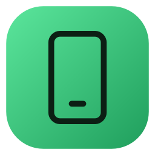
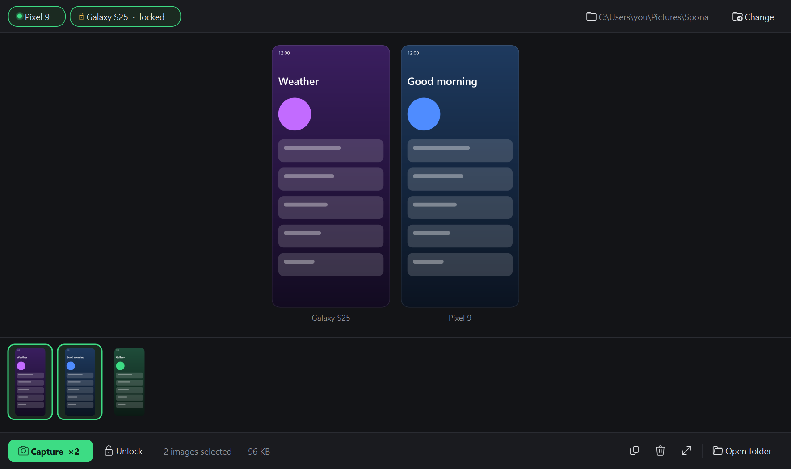

<div align="center">



# Spona

**Screenshots from one or more Android phones in one click.**

A small, fast desktop app built on `adb`. Plug in a phone over USB, press <kbd>F5</kbd>, and the screenshot is saved and shown right away.




</div>

## Features

**Capture**
- Take a screenshot with one click, <kbd>F5</kbd> or <kbd>Space</kbd>; it is saved and shown immediately
- Capture several phones at once. Every connected phone appears as a chip; pick the ones you want and they are captured in parallel and shown side by side
- If a phone screen is off, Spona wakes it up, captures the lock screen, then turns the screen off again

**Phones**
- Live status for each phone: connected, waiting for approval, offline, locked, screen off
- Unlock over adb: Spona wakes the screen, opens the PIN pad and types your PIN or password. You can let it remember the PIN; it is stored encrypted with Windows DPAPI
- Right-click a phone to capture only that one, unlock it, lock it, or forget its saved PIN

**Gallery**
- Thumbnail strip of everything in the save folder, kept in sync with the disk
- Select several shots (<kbd>Ctrl</kbd>/<kbd>Shift</kbd>-click, <kbd>Ctrl</kbd>+<kbd>A</kbd>) to compare them side by side
- Smooth fullscreen viewer that hides its controls while you look
- Copy any image with <kbd>Ctrl</kbd>+<kbd>C</kbd>, the right-click menu, or by dragging it into another app. It pastes as an image in chat apps and as a file in Explorer
- Delete to the Recycle Bin, show the file in Explorer, change the save folder (your choice is remembered)

## Getting started

You need:

1. **Python 3.10+**
2. **[Android SDK Platform-Tools](https://developer.android.com/tools/releases/platform-tools)**. Spona finds `adb` on `PATH`, in `ANDROID_HOME` / `ANDROID_SDK_ROOT`, or in the usual SDK folders. If it is somewhere else, click **Find adb.exe** in the app.
3. **USB debugging** turned on in the phone's Developer options

Clone or download this repository, then from its folder:

```bash
pip install -r requirements.txt
python -m spona
```

On Windows you can also double-click `Spona.pyw` to start it without a console window.

The first time you capture, Spona asks where to save screenshots and remembers your choice. You can change it later with **Change** in the top bar.

## Keyboard shortcuts

| Keys | Action |
| --- | --- |
| <kbd>F5</kbd> or <kbd>Space</kbd> | Capture the selected phones |
| <kbd>Ctrl</kbd>+<kbd>U</kbd> | Unlock the selected phones |
| <kbd>F11</kbd>, <kbd>F</kbd>, <kbd>Enter</kbd> or double-click | Toggle fullscreen |
| <kbd>Esc</kbd> | Leave fullscreen |
| <kbd>←</kbd> <kbd>→</kbd> <kbd>Home</kbd> <kbd>End</kbd>, mouse wheel | Browse screenshots |
| <kbd>Ctrl</kbd>+<kbd>A</kbd> | Select all screenshots |
| <kbd>Ctrl</kbd>+<kbd>C</kbd> | Copy |
| <kbd>Delete</kbd> | Move to the Recycle Bin |
| <kbd>Ctrl</kbd>+<kbd>O</kbd> | Open the screenshots folder |
| <kbd>Ctrl</kbd>+<kbd>L</kbd> | Change the save folder |

## How it works

Spona is a thin layer over standard `adb` commands:

| What | Command |
| --- | --- |
| Find phones | `adb devices -l` |
| Phone name and Android version | `adb shell getprop` |
| Screen and lock state | `dumpsys power`, `dumpsys window`, `dumpsys trust` |
| Screenshot | `adb exec-out screencap -p` |
| Wake, lock | `input keyevent KEYCODE_WAKEUP` / `KEYCODE_SLEEP` |
| Unlock | `wm dismiss-keyguard`, then `input text` with the PIN |

> [!NOTE]
> Only PIN and password locks can be entered over adb. Pattern, fingerprint and face unlock are not supported.

## Privacy

Spona never writes inside its own folder. Everything it stores is local:

| Data | Location |
| --- | --- |
| Settings | `%APPDATA%\Spona\settings.json` |
| Saved PINs (optional, encrypted with Windows DPAPI for your user) | `%APPDATA%\Spona\vault.json` |
| Screenshots | `Pictures\Spona`, or the folder you pick |

Nothing is sent over the network.

## Project layout

```
spona/
├── app.py           entry point and single-instance handling
├── main_window.py   main window and app logic
├── adb.py           adb wrapper: devices, screenshots, screen state, unlock
├── workers.py       background threads: device monitor, capture, unlock
├── devices.py       phone chips in the top bar
├── viewer.py        image view and fullscreen viewer
├── gallery.py       thumbnail strip
├── images.py        image loading, caching and clipboard helpers
├── dialogs.py       PIN dialog
├── vault.py         encrypted PIN storage
├── settings.py      settings file
├── theme.py         colors and styles
├── icons.py         icons and app icon
└── widgets.py       small shared widgets
```

## License

[MIT](LICENSE)
